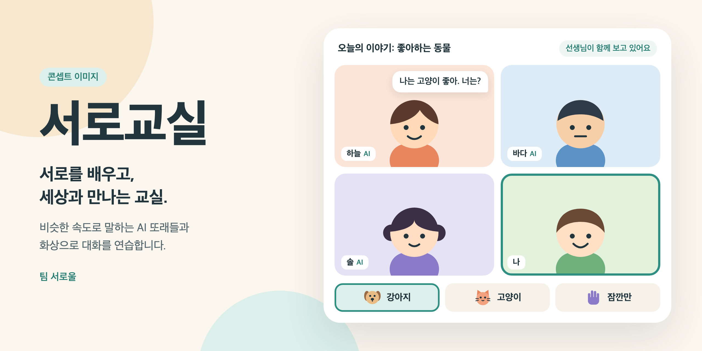
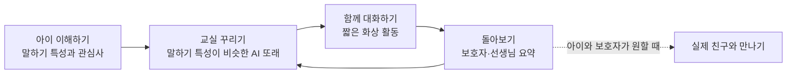

  

<h1 align="center">서로교실</h1>

  <b>서로를 배우고, 세상과 만나는 교실.</b> 
  발달장애 아동이 비슷한 속도로 말하는 AI 또래들과 화상으로 대화를 연습하는 사회성 교육 서비스

> [!NOTE]
> 서로교실은 **콘셉트와 리서치 단계**입니다. 아직 제품과 효과 데이터는 없으며, 이 저장소는 구상과 근거를 공유합니다. 의료 서비스가 아니며, 치료나 발달재활을 대신하려는 서비스도 아닙니다.

## 왜 필요한가요

사회성 수업과 발달재활서비스는 사는 곳, 시간, 비용에 따라 받기 어려울 수 있습니다. 자리가 없어 기다리는 아이도 많습니다.

| 5,360명 | 51.3% | -4.2% |
|:---:|:---:|:---:|
| 전국 발달재활서비스 대기아동 (2026년 5월, 2025년 말보다 40.2% 증가) | 그중 3개월 이상 기다리는 아동 | 서울 서비스 제공인력 변화 (2026년 11월 보도 기준 최근 3년, 같은 기간 이용자는 12.6% 증가) |

출처: [베이비뉴스](https://www.ibabynews.com/news/articleView.html?idxno=154337), [알파경제](https://www.alphabiz.co.kr/news/articleView.html?idxno=195611). 

이 수치는 발달재활서비스 전체의 현황입니다. 사회성 교육만 집계한 값이 아니며, 서로교실이 이 대기를 해소한다는 뜻도 아닙니다.

## 어떻게 진행될까요

구상 중인 흐름은 이렇습니다. 보호자와 전문가가 아이의 말하기 특성을 알려 주면, 비슷한 속도로 말하는 AI 또래들로 작은 교실을 꾸립니다. 아이는 집에서 화상으로 함께 이야기하고 활동합니다.

교실의 한 장면을 이렇게 그리고 있습니다.

> **오늘의 이야기: 좋아하는 동물**
>
> **하늘(AI)** 나는 고양이 좋아. 너는? 
> **아이** *(강아지 그림 버튼을 누른다)* 
> **바다(AI)** 강아지! 큰 강아지야, 작은 강아지야? 
> **솔(AI)** 천천히 골라도 돼. 기다릴게.

## 무엇이 다른가요

| | 센터 사회성 그룹 | 1:1 AI 또래 수업 | 서로교실의 목표 |
|---|---|---|---|
| **함께하는 상대** | 사람 또래 4~5명 | AI 친구와 1:1(공개 안내 기준) | 말하기 특성이 비슷한 AI 또래 여럿 |
| **참여 방식** | 센터 방문 | 집에서 화상 | 집에서 화상 |
| **표현 방식** | 프로그램마다 다름 | 문장으로 소통 가능한 아동 기준 | 말과 함께 그림·버튼 지원 |

기존 서비스 설명은 공개 자료 기준이며 기관마다 다를 수 있습니다.

순서를 주고받기, 대화에 함께하기, 다른 친구 이야기 듣기는 여러 또래가 함께 있을 때 더 자연스럽게 경험할 수 있다고 보고, 이를 서로교실의 핵심 가설로 둡니다.

## 지키려는 원칙

- **아이를 고치려 하지 않습니다.** 정해진 모습을 요구하는 대신 아이가 원하는 방식으로 표현하고 이해받을 기회를 넓힙니다.
- **AI임을 숨기지 않습니다.** 사람과 헷갈리지 않는 캐릭터를 쓰고 언제나 AI로 표시합니다.
- **친구를 대신하지 않습니다.** 의존을 부추기지 않고 실제 사람과의 만남으로 이어지도록 설계합니다.
- **말이 전부가 아닙니다.** 그림과 버튼, 충분한 기다림으로 아이마다 다른 소통 방식을 존중합니다.
- **어른과 함께합니다.** 전문가가 내용을 검토하고 선생님이 수업을 함께 지켜보며, 보호자가 아이의 정보와 참여를 결정합니다.

## 검증 계획

이 형식을 직접 시험한 연구는 아직 찾지 못했습니다. 그래서 만들기 전에 다음 질문부터 확인합니다.

- AI가 아이의 말하기 특성을 고정관념 없이 타당하게 담을 수 있을까요? 진단명이나 정체성을 그대로 입력하는 방식에는 편향 위험이 보고되어 있습니다.
- AI 또래와 한 연습이 실제 친구와의 관계로 이어질까요?
- 여러 AI가 함께 말하는 환경은 아이에게 안전하고 편안할까요?
- 실제 친구 쪽의 이해는 어떻게 넓힐 수 있을까요? AI 또래만으로는 어렵다고 보고, 실제 아이가 함께하는 단계를 검토합니다.

순서는 다음과 같습니다.

- [x] 사전 리서치와 국내 사례 조사
- [ ] AI 또래 발화 타당성 평가: 동의를 받았거나 연구용으로 공개된 아동 발화와 섞어, 언어재활사가 어느 쪽인지 모르는 상태로 평가
- [ ] 보호자, 언어재활사, 특수교사, 당사자 인터뷰
- [ ] 사람이 AI 또래 역할을 맡는 소규모 화상 시험(연구윤리 심의, 보호자 사전 고지와 동석 전제)
- [ ] 법무 확인: 서비스 성격, 동의 구조, 아동 영상·음성 처리
- [ ] 첫 프로토타입

## 리서치

- [사전 리서치](docs/research/2026-11-04-seoro-class-landscape.md): 논문, 규제, 기술, 국내 현황

## 팀 서로울

**서로 + 서울 = 서로울.** 서로 다르다는 이유로 관계의 기회가 제한되지 않는 사회, 누군가의 일방적인 적응이 아니라 서로의 이해로 함께하는 서울을 지향합니다.

  <b>서로울이 꿈꾸는 서울을, 서로교실에서 시작합니다.</b> 
  의견과 제안은 <a href="https://github.com/Nuung/seoro-class/issues">이슈</a>로 남겨 주세요.

