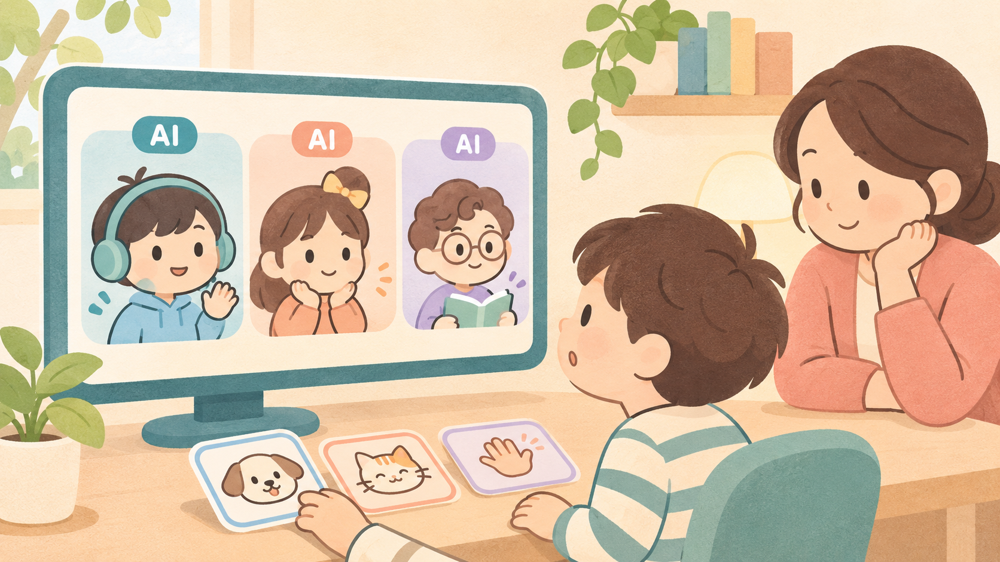
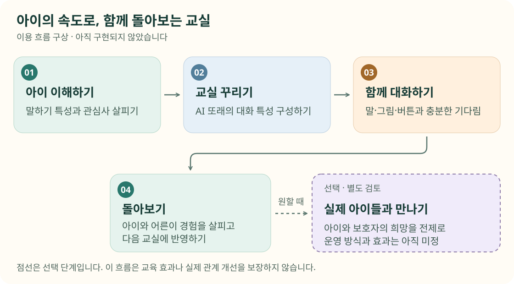
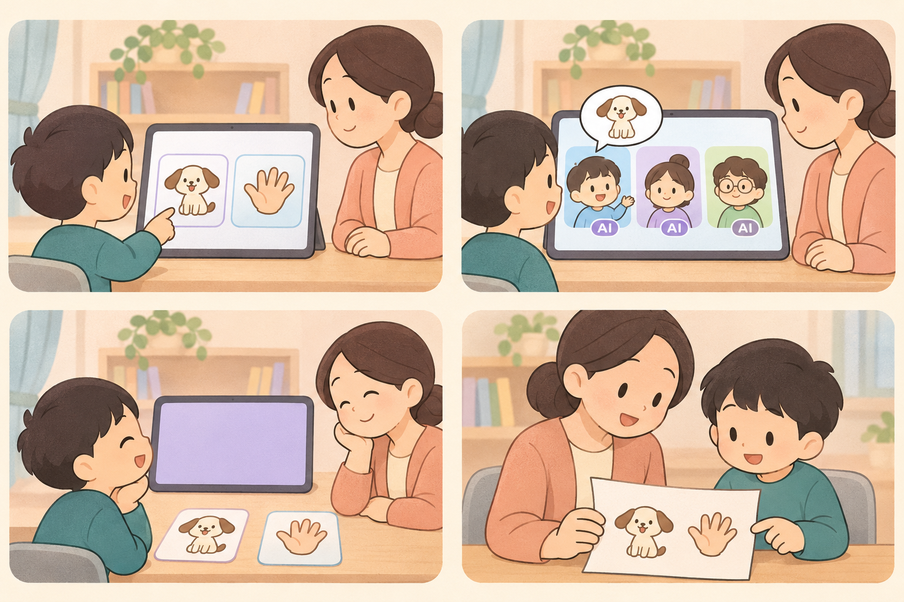

<h1 align="center">서로교실</h1>

  <b>서로를 배우고, 세상과 만나는 교실.</b> 
  발달장애 아동이 비슷한 속도로 말하는 AI 또래들과 
  자신의 방식으로 대화를 연습하는 사회성 교육 서비스 구상

  <b>콘셉트·리서치 단계</b> · 프로토타입 미구현 · 효과 데이터 없음

  <a href="docs/product-concept.md">서비스 구상</a> ·
  <a href="docs/classroom-scenario.md">수업 시나리오</a> ·
  <a href="docs/validation-roadmap.md">검증 계획</a> ·
  <a href="docs/safety-and-privacy.md">안전과 개인정보</a> ·
  <a href="docs/research/2026-11-04-seoro-class-landscape.md">사전 리서치</a>

  

AI 생성 콘셉트 일러스트 · 실제 제품 화면이나 이용 아동이 아닙니다. AI 수와 카드 형태는 예시입니다.

> [!NOTE]
> 아직 제품과 효과 데이터는 없습니다. 이 저장소는 **구상과 근거, 검증할 질문**을 공유합니다. 치료나 발달재활을 대체하려는 서비스가 아닙니다. 아래 기능·운영·보호 조치는 구현 완료가 아닌 지향점이며, 법적 분류와 적용 요건은 별도 검토가 필요합니다.

## 어떤 교실을 그리고 있나요

| 말하기 특성에 맞추기 | 여럿과 이야기하기 | 말 외의 표현도 존중하기 |
|:---:|:---:|:---:|
| 발화 길이·어휘·응답 속도 등을 참고하는 방안 | AI 또래들과 순서를 주고받고 다른 이야기를 듣는 경험 | 그림·버튼과 충분한 기다림으로 참여하는 방식 |

세 가지 모두 **검증할 가설**입니다. AI가 아이를 타당하게 표현하는지, 여러 또래가 있는 구성이 편안한지, 실제 사람과의 관계로 이어지는지는 아직 확인하지 못했습니다.

→ [서비스의 대상·범위·미정 사항 읽기](docs/product-concept.md)

## 아이 이해하기부터, 함께 돌아보기까지

*미구현 이용 흐름입니다. 점선은 선택과 별도 검토가 필요한 단계를 뜻하며, 효과나 관계 개선을 보장하지 않습니다. [벡터 원본](docs/assets/classroom-journey.svg)*

**글로 읽기:** 아이 이해하기 → 교실 꾸리기 → 함께 대화하기 → 돌아보기 → 다음 교실에 반영하기. 실제 아이들과의 만남은 아이와 보호자가 원할 때 별도로 검토하는 단계입니다.

## 한 번의 교실을 그려 보면

*AI 생성 스토리보드 · 가상 장면 · 미구현. 실제 수업 기록이나 효과 사례가 아닙니다. 실물 그림 카드의 자동 인식 기능을 뜻하지 않습니다.*

> **하늘(AI)** 나는 고양이 좋아. 너는? 
> **아이** *(강아지 그림을 고른다)* 
> **바다(AI)** 강아지 골랐구나. 
> **솔(AI)** 천천히 해도 돼.

위 대화는 작성한 예시입니다. 하늘·바다·솔과 AI 세 명은 확정 구성이 아닙니다. 대답하지 않거나, 잘못 알아듣거나, 쉬고 싶은 순간까지 함께 설계하려 합니다.

→ [시나리오와 쉬기·종료·오인식 대응 흐름 보기](docs/classroom-scenario.md)

## 지키려는 다섯 가지 원칙

- **아이를 고치려 하지 않습니다.** 정해진 모습을 요구하는 대신 표현하고 이해받을 기회를 넓힙니다.
- **AI임을 숨기지 않습니다.** 사람과 헷갈리지 않는 캐릭터와 이해 가능한 안내를 지향합니다.
- **친구를 대신하지 않습니다.** 의존을 부추기지 않고 실제 사람과의 연결을 고민합니다.
- **말이 전부가 아닙니다.** 그림과 버튼, 충분한 기다림을 존중합니다.
- **어른과 함께합니다.** 전문가 검토, 선생님의 관찰·개입, 보호자의 참여 결정을 전제로 구상합니다.

이는 달성된 안전 성능이 아니라 **설계의 지향점**입니다. 구체적인 운영과 동의, 영상·음성 처리, 보호 조치는 정해지지 않았습니다.

→ [원칙·제안 조치·미정 사항 구분해서 읽기](docs/safety-and-privacy.md)

## 만들기 전에 확인할 것

| 지금 가진 것 | 다음에 확인할 것 | 아직 없는 것 |
|---|---|---|
| 콘셉트와 사전 리서치 | AI 발화의 타당성, 현장 의견, 안전·동의·데이터 처리 조건 | 첫 프로토타입, 아동 참여 시험 결과, 교육 효과 데이터 |

아동이 참여하는 시험은 필요한 연구윤리·동의·법무·안전 검토를 먼저 마친 뒤 검토합니다. 불확실하면 진행을 보류합니다. **일정이나 효과를 약속하기보다 다음 단계로 갈 근거를 확인하려 합니다.**

→ [검증 질문·방법·진행 판단 흐름 보기](docs/validation-roadmap.md)

## 문제의 배경과 근거

사전 리서치는 발달재활서비스의 접근 여건, 관련 연구, 국내 사례, 기술과 제도를 살펴봅니다. 이 형식을 직접 시험한 연구는 해당 조사 범위에서 찾지 못했으며, 이는 연구가 존재하지 않는다는 뜻이 아닙니다.

기존 리서치에 인용한 접근 여건 수치와 해석 범위

아래는 2026년 11월 4일 기준 사전 리서치에 인용한 보도 수치입니다. 이번 문서 구성 작업에서 원자료를 새로 검증한 결과는 아닙니다.

| 수치 | 원문이 다룬 범위 |
|---|---|
| 5,360명 | 2026년 5월 전국 발달재활서비스 대기아동 |
| 51.3% | 위 대기아동 중 3개월 이상 기다리는 비율 |
| -4.2% | 2026년 11월 보도 기준 최근 3년 서울 서비스 제공인력 변화 |

출처: [베이비뉴스](https://www.ibabynews.com/news/articleView.html?idxno=154337), [알파경제](https://www.alphabiz.co.kr/news/articleView.html?idxno=195611).

**발달재활서비스 전체의 수치입니다.** 사회성 교육만의 수요, 서로교실의 잠재 고객 수, 서비스가 해소할 대기 규모를 뜻하지 않습니다.

→ [논문·제도·기술 조사와 미확인 사항 읽기](docs/research/2026-11-04-seoro-class-landscape.md)

## 문서 길잡이

| 궁금한 점 | 읽을 문서 |
|---|---|
| 누구를 위해 무엇을 만들려 하나요? | [서비스 구상](docs/product-concept.md) |
| 아이가 어떻게 참여하고 쉴 수 있나요? | [수업 시나리오](docs/classroom-scenario.md) |
| 무엇을 확인해야 다음 단계로 가나요? | [검증 계획](docs/validation-roadmap.md) |
| 안전과 개인정보는 어디까지 정했나요? | [안전과 개인정보](docs/safety-and-privacy.md) |
| 어떤 근거를 읽었고 무엇을 모르나요? | [사전 리서치](docs/research/2026-11-04-seoro-class-landscape.md) |
| 그림은 어떻게 만들고 읽어야 하나요? | [시각 자료 안내](docs/visual-guide.md) |
| 향후 구현은 어떤 원칙을 따르나요? | [시스템 설계](SYSTEM_DESIGN.md) |

현재 저장소에는 제품 소스와 테스트 코드가 없습니다. Python 개발 도구 설정은 준비되어 있지만, 실행 가능한 앱이나 채택된 AI·화상 기술 스택이 있는 것은 아닙니다.

## 팀 서로울

**서로 + 서울 = 서로울.** 서로 다르다는 이유로 관계의 기회가 제한되지 않는 사회, 누군가의 일방적인 적응이 아니라 서로의 이해로 함께하는 서울을 지향합니다.

아이의 참여를 어렵게 할 상황, 편안한 표현 방식, 검증에서 놓친 질문에 관한 의견을 [이슈](https://github.com/Nuung/seoro-class/issues)로 남겨 주세요. **공개 이슈에 아동의 이름·얼굴·음성·진단서 등 개인정보를 올리지 말아 주세요.**

<b>서로울이 꿈꾸는 서울을, 서로교실에서 시작합니다.</b>

