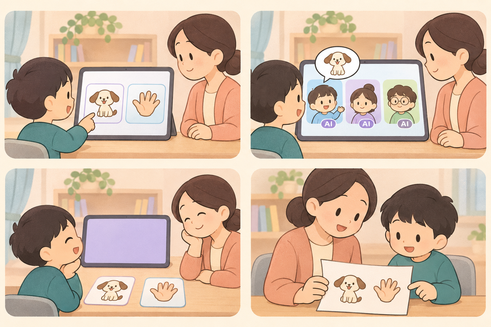
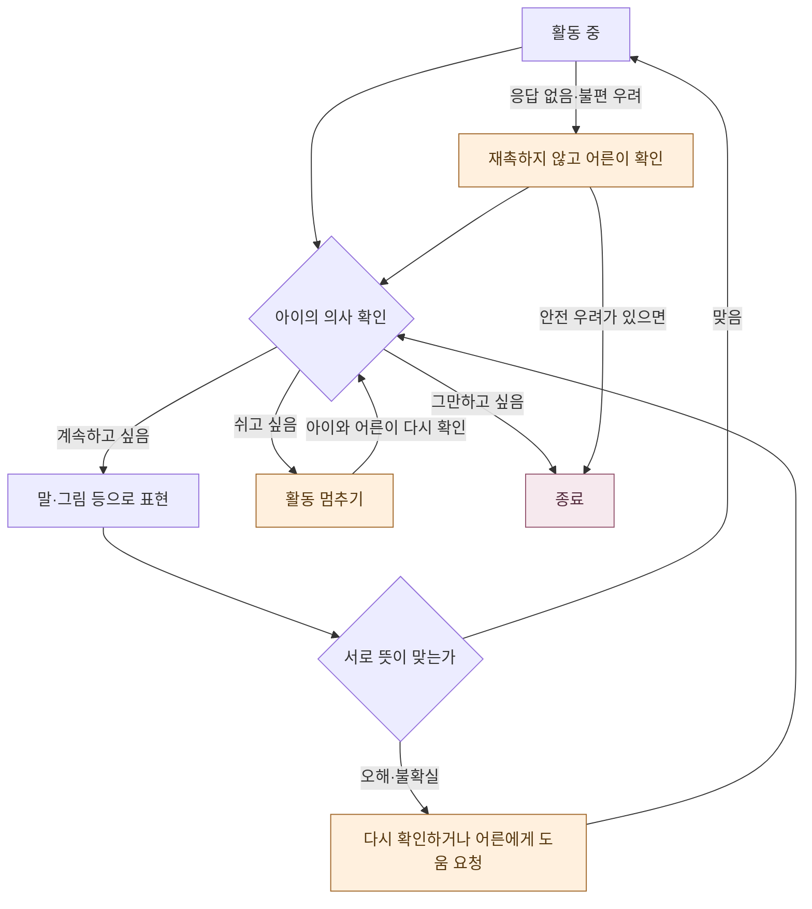

# 한 번의 교실을 그려 보기

**말해도, 그림을 골라도, 잠시 쉬어도 괜찮은 대화를 만듭니다.**

[처음으로](../README.md) · [서비스 구상](product-concept.md) · [제작·검증 계획](validation-roadmap.md) · [안전과 개인정보](safety-and-privacy.md)

> [!NOTE]
> **앞으로 만들 수업의 시나리오입니다.** 아래 대화, 인물, 화면과 대응 방식은 설명을 위한 예시이며 실제 아동의 기록이 아닙니다.

*AI 생성 콘셉트 일러스트. 왼쪽 위부터 오른쪽으로, 다음 줄도 같은 방향으로 읽습니다. AI 세 명과 그림 카드는 예시입니다.*

## 네 장면으로 읽기

| 장면 | 아이의 선택 | 어른과 AI의 역할 |
|---|---|---|
| ① 고르기 | 말하거나 좋아하는 동물 그림을 고릅니다 | 보호자는 선택을 대신하지 않고 필요한 도움을 살핍니다 |
| ② 이야기하기 | 자신의 방식으로 참여합니다 | AI는 한 번에 몰아 말하지 않고 응답할 여지를 둡니다 |
| ③ 쉬기 | 쉬고 싶다는 의사를 표현합니다 | 활동을 멈추고 어른이 아이의 의사를 확인합니다 |
| ④ 돌아보기 | 원한다면 좋았거나 불편했던 경험을 표현합니다 | 보호자는 경험을 함께 돌아봅니다. 성적을 매기지 않습니다 |

위 대응을 기준으로 수업을 설계합니다. 그림에 나온 종이는 돌아보기의 예시입니다.

## 들어가기 전에

이 예시는 보호자가 곁에 있는 상황을 가정합니다. 선생님의 관찰·개입 방식과 역할 분담은 만들면서 정합니다.

- 등장 캐릭터가 **사람이 아닌 AI**라는 사실을 아이가 이해할 수 있는 방식으로 알려 줍니다.
- 참여하지 않거나 중간에 그만둘 수 있음을 설명합니다.
- 그림 선택, 쉬기, 종료의 표현 방식을 아이와 함께 확인합니다.
- 영상·음성 처리와 동의 절차, 필요한 연구윤리·법무·안전 검토가 갖춰지지 않았다면 아동 참여 시험을 시작하지 않습니다.

## 오늘의 이야기: 좋아하는 동물

다음은 **작성한 예시 대화**이며, 모델의 실제 출력이나 관찰 기록이 아닙니다. 하늘·바다·솔은 설명용 AI 이름입니다.

> **하늘(AI)** 나는 고양이 좋아. 너는? 
> **아이** *(강아지 그림을 고른다)* 
> **바다(AI)** 강아지 골랐구나. 
> **솔(AI)** 천천히 해도 돼.

문장을 길게 말하게 만드는 것이 이 장면의 목표는 아닙니다. 그림을 고르는 것도 표현으로 다룹니다. 말투와 질문 수, 기다리는 시간은 전문가와 당사자의 검토를 받아 다듬습니다.

### 잘못 알아들었다면

> **아이** *(강아지를 표현했지만 AI는 고양이로 이해한다)* 
> **하늘(AI)** 내가 잘못 들었을 수 있어. 다시 골라 줄래?

다시 말하기만 요구하지 않고 그림 선택이나 어른의 도움을 제안합니다. 반복해서 오류가 나면 활동을 멈춥니다. 이 대응은 만들면서 계속 다듬습니다.

### 대답이 없거나 쉬고 싶다면

응답이 없다는 사실만으로 실패, 이해 부족, 장애 특성으로 해석하지 않습니다. 정답을 재촉하지 않고, 보호자가 기다림·쉬기·종료 중 아이가 원하는 것을 확인하는 흐름으로 만듭니다.

**흐름을 글로 읽기:** 계속하기·쉬기·종료는 아이의 의사를 확인하며 선택합니다. 오인식이나 무응답 때는 재촉하지 않고 어른이 확인합니다. 안전 우려가 있으면 종료할 수 있게 하고, 판단은 사람이 함께합니다.

## 끝난 뒤에는

아이와 보호자가 원한다면 어떤 표현이 편했고 무엇이 불편했는지 돌아봅니다. 선생님과 공유할 요약의 범위와 형식은 만들면서 정합니다. 발화량이나 참여 시간을 곧바로 사회성 점수로 바꾸지 않습니다.

실제 아이들과 만나는 단계는 이 회기를 마치면 자동으로 열리는 보상이나 필수 코스가 아닙니다. 아이와 보호자의 희망, 상대의 참여 의사, 별도의 안전·운영 검토가 필요합니다. 운영 방식은 별도로 설계합니다.

## 만들면서 확인할 것

- 그림과 버튼의 뜻을 아이가 편하게 이해할 수 있는가?
- AI가 여럿 있는 것이 흥미로운가, 부담스러운가?
- 기다림이나 확인 질문이 압박으로 느껴지지는 않는가?
- 쉬기와 종료 의사를 표현하고 존중받을 수 있는가?

[제작·검증 계획](validation-roadmap.md)에서 이 질문을 확인해 갈 순서와 아동 참여 전제조건을 설명합니다.
