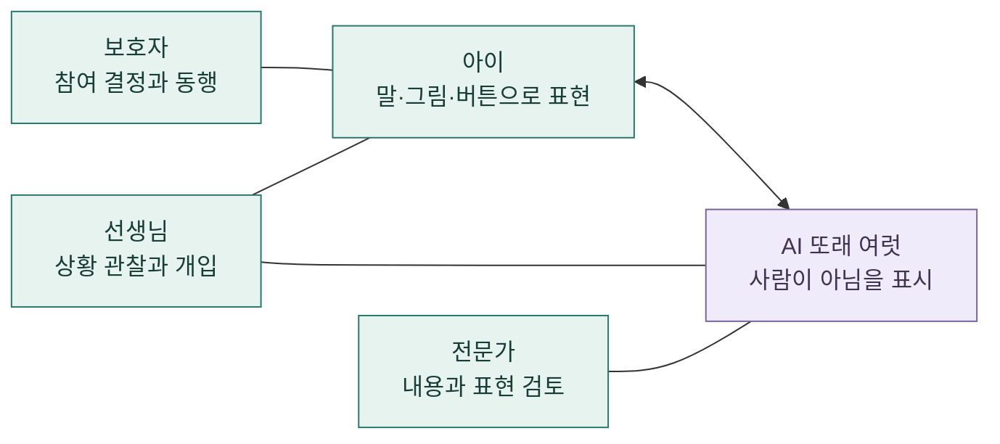

# 서비스 구상

**아이의 속도로 표현하고, 다른 이의 이야기도 만나도록.**

[처음으로](../README.md) · [수업 시나리오](classroom-scenario.md) · [검증 계획](validation-roadmap.md) · [안전과 개인정보](safety-and-privacy.md)

> [!NOTE]
> **현재 상태: 콘셉트와 리서치.** 제품과 효과 데이터는 없습니다. 이 문서는 만들려는 경험을 설명하며, 기능 명세나 운영 실적이 아닙니다.

## 누구를 위한 구상인가요

서로교실은 발달장애 아동이 말하기 특성과 속도가 비슷한 AI 또래 여럿과 화상으로 대화를 연습하는 사회성 교육 서비스 구상입니다. 말뿐 아니라 그림과 버튼으로도 참여할 수 있는 방향을 지향합니다.

다만 **모든 발달장애 아동에게 적합하다고 판단한 것은 아닙니다.** 참여 대상의 연령, 의사소통 방식, 필요한 지원과 수업 환경은 당사자·보호자·전문가와 함께 확인해야 합니다. 진단명만으로 참여 가능 여부나 대화 특성을 정하지 않습니다.

| 참여자 | 만들고 싶은 경험 | 아직 확인할 점 |
|---|---|---|
| 아이 | 자신의 방식으로 표현하고, 기다림을 존중받기 | 어떤 입력과 화면이 편안한가 |
| 보호자 | 참여를 결정하고 아이의 경험을 함께 돌아보기 | 필요한 정보와 개입의 범위는 어디까지인가 |
| 선생님 | 대화 상황을 살피고 필요할 때 개입하기 | 감독 인력, 개입 방식, 운영 여건은 어떠해야 하는가 |
| 전문가 | 활동 내용과 AI 표현의 타당성 검토에 참여하기 | 어떤 기준으로 적합성과 위험을 판단할 것인가 |

## 교실은 어떤 관계로 이루어질까요

아래는 **역할 관계의 구상**입니다. 구현된 시스템 구성도나 데이터 전송 경로가 아닙니다. 보호자·선생님·전문가의 구체적인 역할 분담은 미정입니다.

**글로 읽기:** 아이와 AI 또래가 대화를 연습하고, 보호자와 선생님이 참여를 돕는 구상입니다. 전문가는 내용과 표현을 검토합니다. 실제 아이들과의 만남은 자동으로 이어지는 결과가 아니라 희망과 별도 검토가 필요한 단계입니다.

## 세 가지 핵심 가설

| 가설 | 구상에 반영하는 방식 | 지금 말할 수 없는 것 |
|---|---|---|
| 말하기 특성이 비슷하면 참여하기 편안할 수 있다 | 발화 길이, 어휘, 응답 속도, 관심 주제를 참고하는 방안 | AI가 아동의 발달 수준을 정확히 재현한다는 주장 |
| 여러 또래가 있으면 서로 다른 대화 상황을 경험할 수 있다 | 순서 주고받기, 다른 친구 듣기, 대화에 참여하기 | 1:1보다 효과가 좋다는 주장 |
| 말 외의 선택지가 참여 기회를 넓힐 수 있다 | 그림·버튼과 충분한 기다림 | 모든 아동에게 접근성이 확보됐다는 주장 |

세 가설 모두 직접 검증해야 합니다. 관찰 가능한 말하기 특성으로 캐릭터를 구성하는 방안도 검증된 방법은 아닙니다. 배경과 한계는 [사전 리서치의 해석](research/2026-11-04-seoro-class-landscape.md#7-서로교실에-대한-해석)에 있습니다.

## 무엇을 하지 않으려 하나요

- **아이를 교정의 대상으로 두지 않습니다.** 정해진 말투나 반응을 유일한 정답으로 요구하지 않는 방향입니다.
- **AI를 실제 친구로 속이지 않습니다.** 이름이 있어도 AI라는 사실을 드러내려 합니다.
- **치료나 발달재활을 대신한다고 약속하지 않습니다.** 교육을 지향하며, 법적 분류는 별도 검토가 필요합니다.
- **실제 친구 관계의 개선을 보장하지 않습니다.** AI와의 경험이 사람 관계로 이어지는지는 검증 과제입니다.
- **진단이나 발달 점수를 제공하는 기능은 현재 구상 범위에 넣지 않습니다.** 별도 근거와 검토 없이 확장하지 않습니다.

## 처음 그려 보는 범위와 미정 사항

| 구분 | 내용 |
|---|---|
| 지향하는 경험 | 주제가 있는 대화, 여러 AI 또래, 그림·버튼, 어른의 관여, 돌아보기 |
| 문서에서 제안하는 상호작용 | 쉬기, 종료, 잘못 알아들은 말 다시 확인하기 |
| 예시일 뿐인 요소 | 하늘·바다·솔이라는 이름, AI 세 명, 좋아하는 동물 활동 |
| 미정인 제품 조건 | 참여 연령, AI 수, 회기 길이, 빈도, 비용, 구체적인 활동 구성 |
| 미정인 기술·운영 | 모델, 음성·영상 기술, 저장 구조, 감독 인력, 실제 만남 운영 방식 |

조사 문서의 기술·업체 이름은 채택 결정이 아닙니다. 개발 시 따를 원칙은 [시스템 설계](../SYSTEM_DESIGN.md)에 있으며, 현재 제품 아키텍처는 구현되지 않았습니다.

## 다음으로 읽기

- [수업 시나리오](classroom-scenario.md): 가상의 한 회기를 장면과 대화로 살펴봅니다.
- [검증 계획](validation-roadmap.md): 가설을 확인하고 진행 여부를 판단하는 방법을 제안합니다.
- [안전과 개인정보](safety-and-privacy.md): 원칙과 미구현 보호 조치, 미정 사항을 구분합니다.
