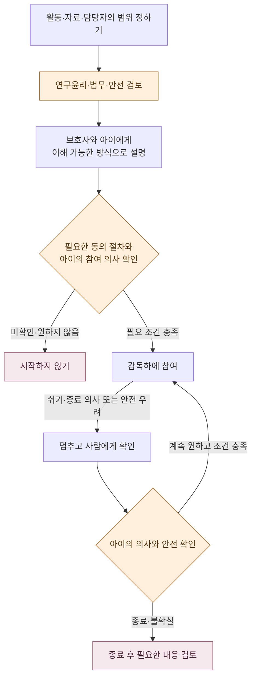

# 안전과 개인정보

**서로교실을 만들며 지킬 약속과 갖춰 갈 보호 조치입니다.**

[처음으로](../README.md) · [서비스 구상](product-concept.md) · [수업 시나리오](classroom-scenario.md) · [제작·검증 계획](validation-roadmap.md)

> [!IMPORTANT]
> **서비스를 만들며 갖춰 갈 보호 조치를 정리한 문서입니다.** 개인정보 처리방침, 법률 자문, 안전 인증 또는 연구윤리 승인을 대신하지 않습니다.

## 지킬 원칙과 만들 조치

| 지킬 원칙 | 만들 조치 | 만들면서 확인할 점 |
|---|---|---|
| 아이의 선택 존중 | 참여하지 않기, 쉬기, 종료를 표현할 수 있는 방법 | 아이가 뜻을 이해하고 실제로 사용할 수 있는가 |
| AI임을 숨기지 않기 | 캐릭터에 AI 표시, 이해 가능한 사전 설명 | 표시만으로 충분한가, 오해가 생기지 않는가 |
| 사람의 관여 | 전문가 내용 검토, 선생님 관찰·개입, 보호자 참여 결정 | 누가 언제 보고 개입하며 운영할 수 있는가 |
| 부담 줄이기 | 한꺼번에 말하지 않기, 오류 시 다시 확인하기, 활동 멈추기 | 감각·인지 부담과 반복 오류를 어떻게 살필 것인가 |
| 실제 관계 대체하지 않기 | 의존을 유도하는 표현을 피하고 회기 단위 경험 검토 | 캐릭터와의 관계를 아이가 어떻게 받아들이는가 |
| 필요한 정보만 다루기 | 목적별 필요성을 검토하고 불필요한 수집을 피하기 | 필수 항목과 선택 항목, 처리 목적은 무엇인가 |

이 표는 자동 유해 발화 차단, 자동 위험 감지, 완전한 접근성이나 안전을 보장하지 않습니다. 사람이 관여한다는 사실만으로 위험이 없어지는 것도 아닙니다.

## 아동 참여 전에 정할 것

아래는 **아동 참여를 결정하는 흐름**입니다.

**글로 읽기:** 무엇을 할지와 어떤 정보를 다룰지 정한 뒤 필요한 검토와 설명을 합니다. 동의 절차와 아이의 참여 의사가 확인되지 않으면 시작하지 않습니다. 참여 중에도 쉬기·종료 의사를 확인하고, 불확실하면 멈춥니다. 구체적인 동의 요건과 대응 절차는 전문가 검토가 필요합니다.

## 데이터 항목별로 정할 것

아래는 만들면서 결정할 검토 후보 목록이며 전부 수집하겠다는 뜻이 아닙니다. 실시간 전달과 녹화·녹음·보관은 서로 다른 처리이므로 구분해 결정해야 합니다.

| 검토 후보 | 필요한지부터 물을 질문 | 만들면서 정할 것 |
|---|---|---|
| 말하기 특성·관심사 | 진단명 없이도 필요한 경험을 구성할 수 있는가 | 입력 항목, 작성·수정 주체, 열람 범위 |
| 아이의 음성 | 음성 외 참여가 가능한가, 실시간 처리만으로 충분한가 | 모델·업체, 외부 전송, 보관 여부, 학습 이용 여부 |
| 아이의 영상 | 아이의 얼굴 영상이 반드시 필요한가 | 촬영 여부, 전달 대상, 녹화 여부, 보관 여부 |
| 그림·버튼 선택 | 수업 중 응답으로만 사용해도 되는가 | 기록 여부, 요약 포함 범위 |
| 대화 내용·회기 요약 | 보호자와 선생님에게 무엇이 필요한가 | 생성·검토 방식, 오류 정정, 열람 권한 |
| 동의·중단 관련 기록 | 필요한 절차를 확인하기 위해 무엇을 남겨야 하는가 | 기록 범위, 보존 기간, 담당자, 요청 대응 |

외부 처리 업체, 처리 지역, 접근 권한, 암호화 방식, 보관 기간, 삭제·철회 절차는 만들면서 정합니다. 정하기 전까지 이 문서로 “외부 전송 없음”, “학습에 사용하지 않음”, “즉시 완전 삭제” 같은 기술적 보장을 하지 않습니다.

## 시험 전에 역할과 대응을 구체화하기

| 상황 | 제안 원칙 | 정해야 할 운영 절차 |
|---|---|---|
| 아이가 불편해하거나 종료 의사를 보임 | 진행을 우선하지 않고 멈추기 | 표현 확인 방법, 중단 권한, 종료 후 확인 |
| AI가 오해하거나 부적절하게 말함 | 아이에게 책임을 돌리지 않기 | 사람의 개입, 대체 활동, 반복 시 중단 기준 |
| 감독자 연결이 끊김 | 감독을 전제로 한 시험을 그대로 계속하지 않기 | 연결 상실 확인과 중단·복구 방식 |
| 개인정보 노출 우려 | 공개 확산을 막고 담당자가 확인하기 | 연락 경로, 접근 제한, 사고 대응과 필요한 후속 조치 |

실제 아동 참여 전에 담당자와 구체적인 대응을 정합니다.

## 공개 저장소에서 의견을 주실 때

공개 이슈에는 **아동의 이름, 얼굴, 음성, 진단서, 연락처, 수업 원문 등 개인정보를 올리지 말아 주세요.** 사례가 필요하면 개인을 식별할 수 없는 가상의 예로 설명해 주세요. 사진이나 자료를 먼저 보내야 의견을 낼 수 있는 구조가 아닙니다.

이 저장소에는 실제 아동 자료가 아닌 콘셉트 일러스트와 작성한 가상 대화를 사용합니다. 관련 법과 제도에 대한 기존 조사는 [사전 리서치](research/2026-11-04-seoro-class-landscape.md)에 있으며, 현행 규정의 적용 관계는 별도 법무 검토로 확인합니다.
