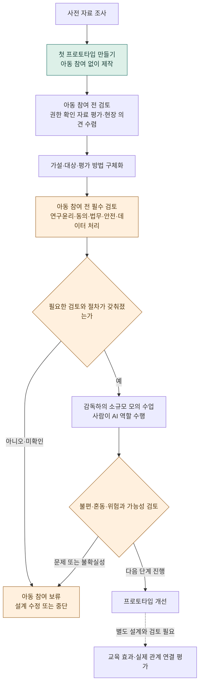

# 제작·검증 계획

서로교실은 먼저 만들어 보여 준 뒤 함께 고쳐 갑니다.

[처음으로](../README.md) · [서비스 구상](product-concept.md) · [수업 시나리오](classroom-scenario.md) · [안전과 개인정보](safety-and-privacy.md)

> [!NOTE]
> 아래에 적은 제작 순서는 제안이며 승인된 연구계획서나 확정 일정이 아닙니다.

## 지금까지 한 일과 앞으로 만들 것

| 상태 | 내용 | 읽을 자료 |
|---|---|---|
| 완료 | 기존 연구·제도·기술·국내 사례에 대한 사전 조사 | [사전 리서치](research/2026-11-04-seoro-class-landscape.md) |
| 완료 | 서비스 방향, 수업 장면, 확인할 질문 | [서비스 구상](product-concept.md), [수업 시나리오](classroom-scenario.md) |
| 다음 | 첫 프로토타입 제작 | 아래 순서 |
| 이어서 | AI 발화 평가, 현장 인터뷰, 소규모 화상 시험 | 아래 순서 |
| 그다음 | 교육 효과와 실제 사람 관계로의 연결 평가 | 아래 순서 |

사전 조사는 이 형식을 직접 시험한 연구를 해당 검색 범위에서 찾지 못했다고 기록합니다. 그래서 직접 만들어 확인합니다. 사전 리서치의 `[검증]`은 그 문서 내부의 근거 검토 표기이지 서로교실의 임상 검증 완료 표시가 아닙니다.

## 만들면서 확인할 질문

아래 방법은 제안입니다. 참여 인원, 평가 도구, 통과 기준과 분석 방법은 적절한 검토를 거쳐 사전에 정해야 합니다. 결과를 본 뒤 유리한 기준으로 바꾸지 않는 방향을 원칙으로 둡니다.

| 질문 | 확인 방법 제안 | 판단할 것 | 만들면서 정할 것 |
|---|---|---|---|
| AI 또래의 표현이 타당한지 | 사용 권한이 확인된 아동 발화와 AI 발화를 섞어 전문가 눈가림 평가 | 왜곡·고정관념·부적절한 표현이 있으면 구성 방식 재검토 | 자료 확보, 평가자, 평가 기준 |
| 현장의 필요와 서비스 방향이 맞는지 | 보호자·언어재활사·특수교사·당사자 의견 듣기 | 필요하지 않거나 부담이 크면 대상과 경험 재검토 | 참여자 구성, 질문, 접근 가능한 진행 방식 |
| 그림·버튼과 기다림이 참여에 도움이 되는지 | 적법한 절차와 감독 아래 표현·쉬기·종료 경험 관찰 | 선택의 뜻이 전달되지 않거나 불편하면 상호작용 재설계 | 관찰 지표, 도움의 범위, 중단 기준 |
| 여러 AI가 있는 환경을 편안하게 경험하는지 | 사람이 AI 역할을 맡는 소규모 화상 시험부터 검토 | 과부하·압박·혼동이 보이면 인원·진행 방식 재검토 | 역할 안내, 대화 순서, 적정 참여 수 |
| 실제 사람 관계로 이어지는지 | AI 안에서의 경험과 실제 사람과의 경험을 구분하는 별도 평가 설계 | 연결을 확인하지 못하면 효과 주장 범위 제한 | 비교 조건, 관찰 기간, 지표와 분석 방법 |

AI 발화의 타당성, 사용 가능성, 편안함, 교육 효과는 서로 다른 질문이므로 한 항목의 긍정적 결과로 나머지를 통과했다고 판단하지 않습니다.

## 만드는 순서와 멈추는 지점

사전 자료를 바탕으로 첫 프로토타입을 만들고 가설과 평가 방법을 구체화합니다. 아동이 참여하기 전에는 연구윤리·동의·법무·안전·데이터 처리 검토를 마쳐야 하며 충족 여부가 불확실하면 보류합니다. 모의 수업 결과로 프로토타입을 개선하고 효과 평가는 별도 단계로 둡니다.

이 도식으로 연구윤리 심의 승인이나 법적 요건 충족을 선언하지 않습니다. 아동 발화 자료의 이용과 현장 인터뷰도 각각 필요한 동의·윤리 검토 범위를 먼저 확인해야 합니다. 당사자 인터뷰에 아동이 참여한다면 같은 아동 참여 전제조건을 적용합니다.

## 결과를 남길 때의 원칙

- 방법과 한계를 함께 남기고 누구에게, 어떤 조건에서, 무엇을 관찰했는지 구분
- 긍정적인 장면만 고르지 않고 중단, 불편, 오인식, 참여하지 않은 경우도 해석에 필요한 범위에서 검토
- 수업 안의 지표와 실제 관계를 구분하며 대화량이 늘었다고 친구 관계가 개선되었다고 쓰지 않음
- 자료 공개는 별도로 판단하며 투명성을 이유로 아동의 원음·영상·식별 정보를 공개하지 않음. 공개 범위는 동의와 재식별 위험 등을 검토한 뒤 결정
- 미확인 결과는 미확인으로 두고 가설에 맞지 않는 결과도 다음 설계의 판단 근거로 남기려 함

## 만들면서 정할 것

참여 대상과 인원, 수행 기관과 인력, 평가 도구, 통과·중단 기준, 일정과 예산은 만들면서 정합니다. 효과는 확인한 만큼만 말합니다.

기존 연구의 대상·형식 차이와 검색 한계는 [사전 리서치](research/2026-11-04-seoro-class-landscape.md)에 있습니다. 실제 시험의 정보 처리 쟁점은 [안전과 개인정보](safety-and-privacy.md)에서 확인할 수 있습니다.
